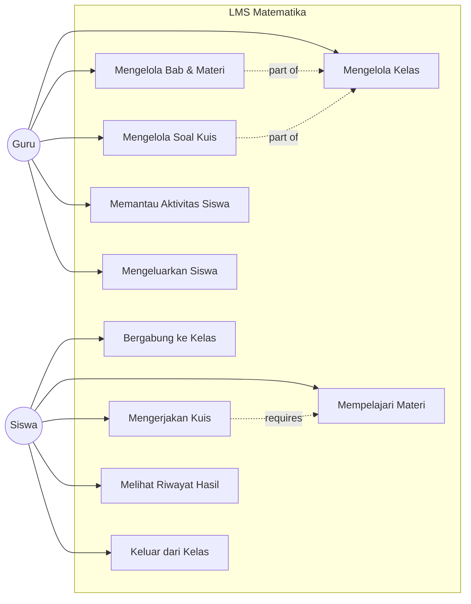
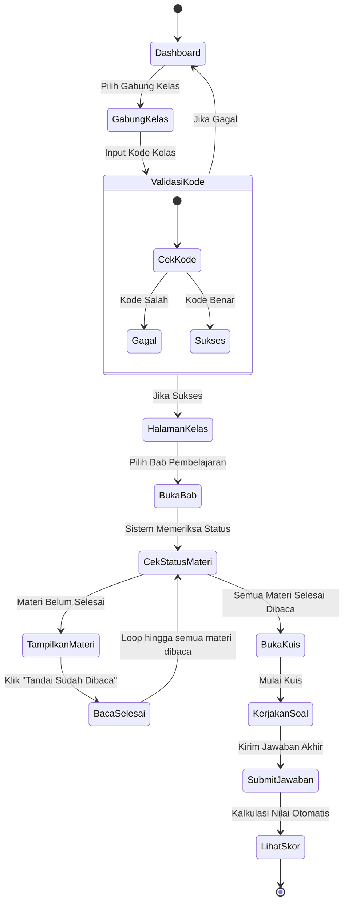
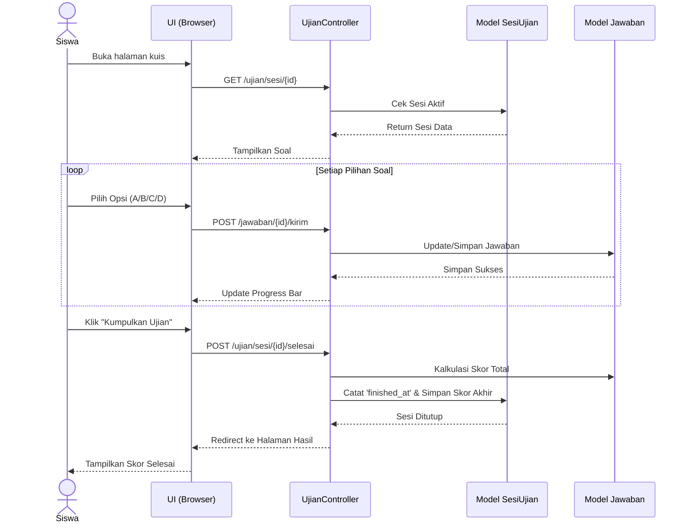

# Dokumentasi Sistem LMS Matematika

Aplikasi ini adalah *Learning Management System* (LMS) khusus Matematika yang dirancang dengan antarmuka premium ("Brand Red"), sistem pembelajaran sekuensial, dan manajemen ujian *real-time*.

---

## 📁 Peta Struktur File & Folder (Penjelasan Lengkap)

Sistem ini menerapkan pemisahan peran (*role-based*) yang ketat antara **Guru** dan **Siswa**. Berikut adalah penjelasan mendetail untuk setiap folder dan file pembangun aplikasi ini:

### 1. 📂 `app/` (Inti Logika Aplikasi)
Berisi seluruh logika bisnis (*backend*) aplikasi.

#### `app/Http/Controllers/`
Pengendali yang menjembatani antara Database dan Tampilan (View).
*   **`Guru/`** *(Modul Pengajar)*
    *   `BabController.php`: Mengelola siklus hidup Bab (Membuat, Mengedit, Menghapus bab dari kurikulum).
    *   `KelasController.php`: Mengelola ruang kelas virtual, melihat performa siswa, dan mengeluarkan siswa dari kelas.
    *   `MateriController.php`: Mengelola materi (teks, PDF, link YouTube) dan menangani unggahan file ke *storage*.
    *   `SoalController.php`: Logika untuk membuat dan memvalidasi bank soal pilihan ganda beserta kunci jawabannya.
    *   `TeksBabController.php`: Menangani teks ringkasan untuk setiap bab.
*   **`Siswa/`** *(Modul Siswa)*
    *   `GabungKelasController.php`: Memvalidasi kode unik saat siswa mencoba bergabung ke dalam kelas.
    *   `BabController.php`: Menampilkan daftar kurikulum kelas ke siswa dan memverifikasi prasyarat status baca materi.
    *   `MateriController.php`: Menampilkan antarmuka pembelajaran interaktif (PDF/Video) dan mencatat progres belajar siswa.
    *   `UjianController.php`: Mesin utama kuis. Menghitung skor secara *real-time*, memproses jawaban, dan mengakhiri sesi.
*   **`Auth/`**: File keamanan bawaan Laravel Breeze untuk Login, Register, dan Lupa Password.
*   `ProfileController.php`: Mengurus pembaruan nama pengguna dan *password*.

#### `app/Models/`
Representasi dari tabel-tabel di Database (Menggunakan Eloquent ORM).
*   `User.php`: Pengguna sistem. Menyimpan *role* (guru/siswa) dan mengatur relasi siapa mengajar siapa.
*   `Kelas.php`: Ruang kelas digital, menampung `class_code` yang unik.
*   `Bab.php`, `Materi.php`, `Soal.php`: Ketiganya membangun struktur Hierarki Kurikulum.
*   `JawabanSiswa.php` & `SesiUjian.php`: Mencatat performa dan pilihan jawaban murid saat ujian.

### 2. 📂 `resources/views/` (Antarmuka Tampilan / UI)
Di sinilah letak HTML dan logika presentasi (Blade) untuk antarmuka "Brand Red".

*   **`guru/`**
    *   `kelas/` (`index`, `buat`, `edit`, `tampil`): Manajemen tampilan daftar kelas guru hingga dasbor analitik kelas.
    *   `bab/`, `materi/`, `soal/`: Formulir manajemen konten kurikulum pendidikan.
    *   `teks/edit.blade.php`: Antarmuka untuk memperbarui ringkasan teks bab.
*   **`siswa/`**
    *   `kelas/gabung.blade.php`: Halaman input kode kelas bagi siswa.
    *   `bab/index.blade.php`: Halaman katalog bab yang tersedia untuk dipelajari siswa.
    *   `bab/tampil.blade.php`: Halaman verifikasi prasyarat materi sebelum membuka ujian.
    *   `materi/tampil.blade.php`: Halaman tempat siswa membaca PDF atau menonton video materi.
    *   `ujian/` (`index`, `tampil-soal`, `hasil`, `riwayat`): Rangkaian antarmuka daftar ujian, *live quiz*, skor akhir, dan tabel riwayat belajar.
*   **`components/`**: Komponen UI yang dapat dipakai ulang (seperti `application-logo.blade.php` yang memuat `logo-LMS.jpg`).
*   **`layouts/`**: Kerangka pembungkus utama (*navbar*, struktur halaman).
*   `dashboard.blade.php`: Halaman penyambutan cerdas. Isinya berubah dinamis; Guru akan melihat ringkasan statistik kelas, Siswa akan melihat daftar kelas dan *live feed* ujian mereka.
*   `welcome.blade.php`: *Landing page* depan situs.

### 3. 📂 `routes/` (Jalur Navigasi)
*   **`web.php`**: Buku peta seluruh aplikasi. Mendaftarkan seluruh alamat URL situs dan mengarahkannya ke Controller yang tepat menggunakan pengelompokan `prefix` dan `middleware`.

### 4. 📂 `public/` (Aset Terbuka)
*   `assets/logo-LMS.jpg`: Gambar logo aplikasi.
*   `build/`: Tempat di mana Laravel Vite menyimpan hasil *compile* CSS Tailwind yang ringan dan cepat.

---

## 🔄 Alur Sistem (System Flow Diagram)

Berikut adalah visualisasi teknis mengenai alur interaksi dan logika bisnis yang berjalan di dalam aplikasi.

### 1. Use Case Diagram
Memetakan interaksi fungsional antara Aktor (Guru dan Siswa) dengan Sistem LMS.



### 2. Activity Diagram (Alur Belajar Siswa)
Menggambarkan aturan utama sistem (*Sequential Learning*): Siswa wajib membaca materi secara keseluruhan sebelum sistem membuka akses ke soal kuis.



### 3. Sequence Diagram (Pengerjaan Kuis)
Menunjukkan proses kalkulasi dan pertukaran data secara *real-time* dari Browser (UI) ke Database saat ujian berlangsung.



### 4. BPMN Flow (Manajemen Kelas oleh Guru)
Merepresentasikan alur kerja bagi guru dalam mempersiapkan kelas digital.

```mermaid
flowchart TD
    subgraph Guru["Pool: Guru (Pengguna)"]
        A1([Mulai]) --> A2[Buat Kelas Baru]
        A2 --> A3[Dapatkan Kode Akses Kelas]
        A3 --> A4[Buat Bab Baru]
        A4 --> A5{Tambah Konten?}
        
        A5 -- Ya: Materi --> A6[Unggah Teks / PDF / Link Video]
        A6 --> A5
        
        A5 -- Ya: Kuis --> A7[Buat Soal Pilihan Ganda]
        A7 --> A8[Tentukan Kunci Jawaban Benar]
        A8 --> A5
        
        A5 -- Tidak / Selesai --> A9[Bagikan Kode Kelas ke Siswa]
        A9 --> A10([Selesai])
    end
    
    subgraph Sistem["Pool: Sistem LMS (Backend)"]
        B1[Generate Kode Unik (6 Karakter)]
        B2[Simpan Relasi Bab -> Kelas]
        B3[Simpan File Fisik ke Storage & Metadata ke DB]
        B4[Simpan Soal & Validasi Pilihan Ganda]
    end
    
    %% Cross-pool communications
    A2 -.->|Request| B1
    B1 -.->|Return Code| A3
    
    A4 -.->|Insert Data| B2
    A6 -.->|Upload File| B3
    A7 -.->|Insert Data| B4
    A8 -.->|Update Status| B4
    
    classDef startEvent fill:#d4edda,stroke:#28a745,stroke-width:2px;
    classDef endEvent fill:#f8d7da,stroke:#dc3545,stroke-width:2px;
    classDef systemTask fill:#e2e3e5,stroke:#6c757d,stroke-width:1px,stroke-dasharray: 5 5;
    
    class A1 startEvent;
    class A10 endEvent;
    class B1,B2,B3,B4 systemTask;
```
